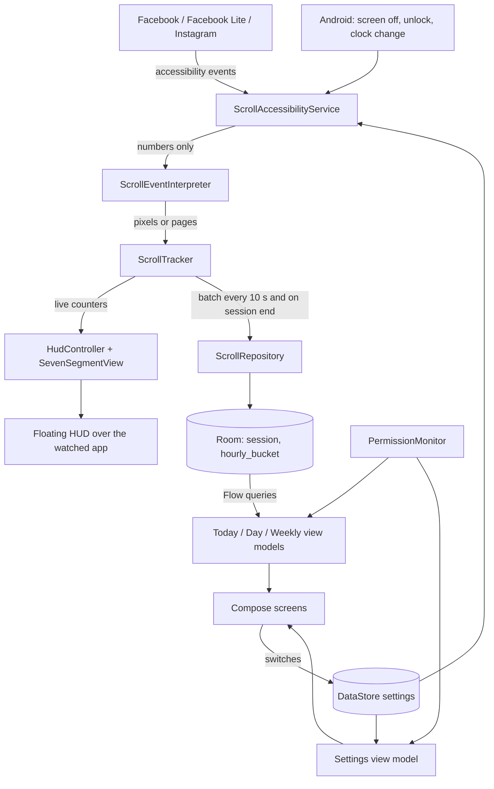
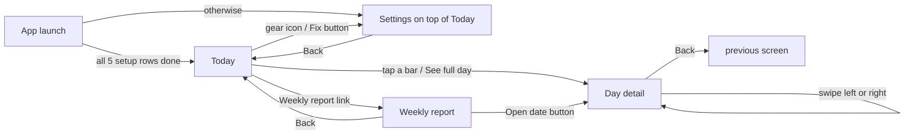

# Scroll Meter: flow and features

This file explains what the app does, how the pieces connect, what goes in and out of each
piece, and every place where the code differs from the PRD or the design spec. Keep it up
to date: when a feature or flow changes, edit the matching section and add a line to the
[change log](#12-change-log) at the bottom.

Source documents: [Product Requirements](Scroll%20Meter%20%E2%80%94%20Product%20Requirements.md)
and [Design Spec](Scroll%20Meter%20%E2%80%94%20Design%20Spec.md). IDs such as `F5`, `FR3.2`,
`E11` and `U9` refer to those documents.

## 1. Status

| Item | State |
| --- | --- |
| Source code for v1 (F1 to F10) | Written |
| APK | Built: debug and release, `minSdk 30`, `targetSdk 35`, no `INTERNET` permission (checked with `aapt2`), signature verified |
| JVM tests | 94 of 94 pass: 81 logic tests (U1 to U13 and more), 4 integration tests, 9 screenshot renders |
| Android lint | 0 errors |
| Screens | Rendered on the JVM from the real code and compared by eye with the design spec; see `docs/screenshots/` |
| Run on a phone or emulator | **Not done.** No emulator was installed. Real-Android behaviour (window types, Realme battery rules) and what Facebook and Instagram actually send are unverified. |
| Instrumented tests | `ScrollDaoTest` compiles, not run. I2 and I6 are not written. |
| Manual checklist on the Realme phone | Not started. It is the real acceptance test. |

## 2. The app in one picture

One service feeds one tracker. The tracker is the only place that turns events into
numbers, so the HUD and the dashboard always agree.

## 3. Features

| ID | Feature | State | Where it lives |
| --- | --- | --- | --- |
| F1 | Detect Facebook, Facebook Lite, Instagram in the foreground | Done | `service/ScrollAccessibilityService.kt` (`onWindowEvent`, `syncActive`) |
| F2 | Count strokes, downward only | Done | `service/ScrollEventInterpreter.kt`, `service/ScrollTracker.kt` (`onScroll`, `onPage`) |
| F3 | Distance in metres from real screen DPI | Done | `service/Distance.kt`, `ScrollTracker.count` |
| F4 | Sessions (start, end, app, strokes, metres) | Done | `ScrollTracker.ensureSession`, `close` |
| F5 | Floating seven-segment HUD, tap-through | Done | `service/HudController.kt`, `SevenSegmentView.kt`, `HudFormat.kt` |
| F6 | Today screen | Done | `ui/today/` |
| F7 | Day detail screen | Done | `ui/day/` |
| F8 | Weekly report with peak-hours heatmap | Done | `ui/weekly/` |
| F9 | Setup and settings with permission checklist | Done | `ui/settings/`, `util/Permissions.kt` |
| F10 | Tracking-stopped warning | Done | `Health.trackingStopped`, `TrackingStoppedCard` |
| F11 to F14 | Milestones, weekly notification, widget, CSV export | Not built (v1.1 and later) | |

## 4. Flow: from a finger swipe to a number

1. **Event arrives.** Android sends `TYPE_VIEW_SCROLLED` to `ScrollAccessibilityService.onAccessibilityEvent`.
2. **Package filter.** `onScrollEvent` drops the event unless the package is a watched app that is switched on in Settings. Nothing is read from other apps.
3. **Self-heal.** If the tracker thinks no watched app is open but one is scrolling, the service marks it as the foreground app (skipped for 500 ms after leaving, to ignore stragglers).
4. **Interpret.** `ScrollEventInterpreter.interpret` receives only numbers and the view class name and returns downward pixels or reel pages:
   - `scrollDeltaY` when present (FR2.2);
   - else the change in `scrollY` for the same view (FR2.3);
   - else the change in `fromIndex` (FR2.3 and FR2.4): one page for a full-screen pager, a share of a screen for a list;
   - upward (FR2.5), horizontal (FR2.6) and jumps over two screen heights return nothing.
5. **Count.** `ScrollTracker.onScroll`:
   - events closer than 300 ms form one burst = one stroke (FR3.1, FR3.2);
   - a burst counts only after it has moved 24 dp (FR3.4);
   - `ScrollTracker.onPage` adds exactly one stroke and one screen height per reel (FR3.3).
6. **Attribute.** `count` adds strokes, pixels and metres to the open session, to today's in-memory totals and to the current hourly bucket. `ensureSession` starts, resumes or splits the session (see section 5).
7. **Show.** The service asks for a HUD refresh, at most once per 100 ms (FR7.2). `HudFormat` builds the two strings and `SevenSegmentView` redraws only if a string changed.
8. **Save.** Every 10 s while a watched app is open, and whenever a session ends, `ScrollTracker.flush` hands a `FlushBatch` to a queue. A single background coroutine writes it with `ScrollDao.applyBatch` (bucket amounts are added, sessions are replaced by id).
9. **Display.** Room `Flow` queries re-emit, the view models rebuild their state with the pure functions in `Aggregator`, and the screens redraw.

## 5. Flow: sessions

| Event | What the tracker does | Rule |
| --- | --- | --- |
| First counted scroll in a watched app | Starts a session | FR5.1 |
| User leaves the app | Session is closed in the database at the leave time, but remembered for 60 s | FR5.2 |
| Back in the same app within 60 s, then scrolls | The same session is reopened and continues | FR5.3, E2 |
| Back after 60 s, or in a different app | New session | U7 |
| Screen turns off | Session closed, not resumable; unlocking starts a new one | FR1.4, E1 |
| No scroll for 5 minutes | Session closed at the time of the last scroll (checked on the 10 s tick and on the next scroll) | FR5.2, U8 |
| A scroll arrives after midnight | Old session ends at 00:00, a new one starts at 00:00 on the new day | FR5.5, E11, U9 |
| Session still open past midnight with no scrolling | It ends at 00:00; no empty second session is created | see section 10 |
| Clock or time zone changes | Day is taken from the local date at the time of each event; past days are never rewritten | E17 |
| Process killed | Up to 10 s of numbers lost; on the next start, sessions left open are closed at their last recorded scroll | E13 |

## 6. Flow: when the HUD shows

The HUD is visible only when all of these are true: the phone is unlocked, the foreground
window belongs to a watched app that is switched on, and "Show counters while scrolling" is on.

| Situation | Result | Case |
| --- | --- | --- |
| Open Facebook / Instagram | Windows added immediately | F5 |
| Home, recents, another app, our own app | Removed immediately | I3, E2 |
| Notification shade, volume panel, system dialog | Stays (those windows are ignored) | E3 |
| Keyboard | Stays; the HUD is not focusable so typing is unaffected | E4, FR7.5 |
| Screen off / locked | Removed | E1 |
| Rotation | `onConfigurationChanged` moves both counters to the new top corners and re-reads screen height and DPI | E6, I6 |
| "Display over other apps" revoked | No effect on the normal window type; tracking continues either way | E19 |

Window details: two `WRAP_CONTENT` windows of type `TYPE_ACCESSIBILITY_OVERLAY` with
`FLAG_NOT_TOUCHABLE | FLAG_NOT_FOCUSABLE | FLAG_LAYOUT_IN_SCREEN`, 14 dp from the side edge
(plus any side cutout) and status bar or cutout height + 6 dp from the top. If that window
type cannot be added, `HudController` falls back to `TYPE_APPLICATION_OVERLAY` at 80%
opacity, which is the most Android 12+ lets taps pass through.

## 7. Flow: screens and navigation

- Navigation is a small back stack in `NavViewModel` (`MainActivity.kt`); there is no navigation library.
- `MainActivity.onResume` refreshes permissions and "today", so Settings rows tick as soon as the user returns from a system page.
- Today: tapping a past date in the strip switches the whole screen to that day; the sub-row label becomes the date.
- Weekly: tapping a bar moves the tooltip; choosing a week tab reloads everything below it.

## 8. Ins and outs of every part

| Part | In | Out |
| --- | --- | --- |
| `ScrollAccessibilityService` | Accessibility events (event type, package, class name, scroll numbers); screen off / on / unlock; clock changes; settings | Calls into the tracker; shows / hides / updates the HUD; queues database writes; `ServiceStatus` |
| `ScrollEventInterpreter` | View key, class name, `scrollDeltaX/Y`, `scrollX/Y`, `fromIndex`, `toIndex`, screen height | `outPixels` or `outPages`, or "ignore" |
| `ScrollTracker` | App entered / left, screen off, downward pixels, pages, 10 s tick, clock change, seed from database | `todayStrokes`, `todayMetres`, `sessionStrokes`, `sessionMetres`, `version`; `FlushBatch` (sessions + bucket amounts) |
| `HudController` | Two strings, style (height, colour, outline) | Two overlay windows |
| `SevenSegmentView` | A string of `0-9`, `.`, `m` | Rectangles on a canvas |
| `ScrollRepository` / `ScrollDao` | `FlushBatch` | Rows in `session` and `hourly_bucket`; `Flow` queries |
| `SettingsStore` | Switch, size, colour, decimal and outline changes from Settings; "scroll seen" / "quiet visit" notes from the service | `Flow<AppSettings>` |
| `PermissionMonitor` | System state (accessibility list, overlay permission, battery whitelist, optional usage stats) | `StateFlow<SystemPermissions>` |
| `Aggregator`, `Weeks`, `NiceScale` | Lists of hourly buckets | Day and week summaries, 24-hour slots, heatmap, averages, chart scales |
| `SessionMapper` | Session rows | List rows (hides sessions under 3 strokes, FR5.4) |
| View models | Repository flows, today's date, permissions | One immutable UI state per screen |
| Screens | UI state | Taps: navigation, date / week / bar selection, setting changes (watched apps, HUD on / off, mode, style), "Allow" deep links |

What is stored: session rows and hourly totals (numbers and app key only). What is never
read or stored: text, names, posts, the view tree, raw events. The manifest has no
`INTERNET` permission and actively removes it if a library adds one.

## 9. Data model

`session` (one row per session): `id`, `app`, `startedAt`, `endedAt` (null while open),
`strokes`, `pixels`, `metres`, `day`, `lastScrollAt`.

`hourly_bucket` (one row per app per hour): `day`, `hour`, `app` (composite key), `strokes`,
`metres`. Every chart and total is computed from this table (FR6.2).

Settings (DataStore): `watch_facebook`, `watch_facebook_lite`, `watch_instagram`,
`overlay_enabled`, `overlay_mode`, `hud_digit_height_dp`, `hud_colour`, `hud_decimals`,
`hud_outline`, plus `auto_launch_confirmed` and per-app `scroll_seen_*`, `quiet_ms_*`,
`quiet_visits_*`.

## 10. Additions and differences from the PRD and design spec

Read this section before testing; each item is a decision made while building.

**Check these first**

1. **Counter style controls were added to Settings (not in the design spec's layout).** The Floating counter card now has four extra rows below the segmented control: Digit size (− / + in 2 dp steps, 16 to 48 dp), Colour (green, amber, white, cyan), Show one decimal, and Black outline. The spec defines these options but gives them no place on the screen. Check the look against your mockups; see `docs/screenshots/settings.png`.
2. **Mockups canvas not seen.** The "Scroll Meter Mockups" canvas was not in the project folder, so the screens follow the written design spec only. Compare `docs/screenshots/` with your mockups. Positions the spec does not state were chosen: the "Avg." tag sits on the line at the left edge of the plot (it can overlap a tall first bar); the "Peak" tag sits above its column.
3. **Fonts.** Plus Jakarta Sans is not bundled. The app and the screenshots use the system font until four TTF files are added; see the README.

**Changed on purpose**

4. **Android 11+ (`minSdk 30`)** instead of the PRD's 28, as requested.
5. **No `packageNames` filter on the service** (FR2.1 and the privacy section asked for one). The service must also see window changes from other apps to know when the user leaves (FR1.1, E2), and Android cannot filter packages per event type. The filter is the first line of the scroll handler instead, so events from other apps are dropped unread.
6. **Session `id` is assigned by the tracker** (time-based) instead of auto-generated, and there is one extra column, `lastScrollAt`, used to close sessions left open by a killed process.
7. **Facebook Lite is drawn as Facebook (blue) on charts, legends and app tiles.** In session rows and Settings it has its own lighter dot.

**Added**

8. **Self-heal and unlock restore.** A scroll from a watched app re-activates tracking if a window change was missed; after unlock, tracking resumes if the watched app is still on top.
9. **Jump filter.** A single event moving more than two screen heights is treated as a programmatic jump and ignored.
10. **"Not supported on this phone" rule (E15).** An app is marked unsupported after 10 minutes in the foreground over at least 3 visits with zero counted scrolls. It clears itself on the first counted scroll.
11. **Debug log (E14).** In debug builds, or after `adb shell setprop log.tag.ScrollMeter DEBUG`, each scroll event's numbers are logged under the tag `ScrollMeter`.
12. **Overflow menus** on Day detail and Weekly report hold one disabled item, "Share as image (coming later)".

**Interpretations where the documents were silent**

13. Bursts under 24 dp add no distance either (FR3.4 only mentions strokes).
14. A session open past midnight with no scrolling after 00:00 ends at 00:00 instead of creating an empty second session.
15. HUD metres are cut, never rounded up; from 10,000 m it shows km with one decimal and no unit ("12.4"), the PRD's proposed default.
16. Hero distances under 10 m show whole metres ("7 m") instead of "0.00 km". Session rows and the peak-hour tile show metres under 1 km. The weekly average uses one decimal, as in the spec's example.
17. Daily average divides by the days that have data, up to today (FR6.4).
18. The busiest hour is the hour of day with the most metres summed over the week.
19. Setup opens on every launch until all five rows are ticked; Back goes to Today. "Allow restricted settings" is ticked when accessibility is on (or on Android 11 and 12, where it does not exist). "Auto launch" cannot be detected, so it is ticked once its page has been opened.
20. The tracking-stopped card shows when accessibility is off, or (only if Usage access was granted by hand) when a watched app was used for 3 minutes today with zero strokes. Usage access has no row in Setup, to keep "N of 5".
21. For earlier weeks the comparison card says "Week 39" / "Week before" instead of "This week" / "Last week".
22. Hourly bars on Day detail are not tappable (no action is specified).
23. Debug and release are signed with the same key, kept in `signing/debug.keystore` (git-ignored), so either APK installs over the other and any computer holding that file can build an update. Back the file up.
24. Each screen is split into a thin `…Screen` (reads the view model) and a stateless `…Content` (draws a state), so tests can render screens from seeded data. `LocalAnimateCharts` lets tests skip the 350 ms bar animation.
25. Test-only libraries were added: Robolectric and Roborazzi. They are not in the APK.

## 11. Edge cases and tests

| Case | Handled by | Automated check |
| --- | --- | --- |
| E1 lock while open | `onScreenOff` | `e1_screenOffEndsSession_andUnlockStartsANewOne` |
| E2 quick app switch | resume window | `u6_…`, `u7_…` |
| E3 shade, E4 keyboard, E22 own windows | `isIgnoredWindow` | manual |
| E5 in-app browser | same package, so counted | manual |
| E6 rotation | `onConfigurationChanged` | manual |
| E7 split screen / PiP | partly: focus changes drive the foreground app | manual |
| E8 upward, E9 horizontal | interpreter | `fr2_5_…`, `fr2_6_…` |
| E10 stories (taps) | no scroll events, so not counted | manual |
| E11 midnight | `ensureSession`, `close` | `u9_…`, `e11_…` |
| E12 reboot | Android rebinds enabled accessibility services | manual |
| E13 process killed | 10 s flush, `closeDanglingSessions` | `danglingOpenSessionIsClosedAtItsLastScroll` (instrumented) |
| E14 app update changes views | debug log | manual |
| E15 Facebook Lite | fallbacks + unsupported rule | `fr2_3_…`, `fr2_4_…` |
| E16 display / font size | physical `ydpi` | `u1_…`, `fr4_2_…` |
| E17 time zone / clock | local date per event | `e17_…` |
| E18 long session | no timers drift; counters are plain sums | manual |
| E19 overlay revoked, E20 accessibility off | fallback handling, `Health` | `fr8_1_…` |
| E21 no data | empty states | `e21_firstDayIsAnEmptyState` |

PRD unit tests: U1 to U10 in `ScrollTrackerTest`, U10 and U11 in `AggregatorTest`, U12 and
U13 in `HudTest`. Extra: `ScrollEventInterpreterTest`, `FmtAndSessionTest`,
`ScreenStateTest` (the numbers half of I7, FR8, Setup count).

JVM stand-ins for the emulator tests, using Robolectric:

| PRD test | Stand-in | What it proves |
| --- | --- | --- |
| I1 scrolling list counted | `AppIntegrationTest.service_countsScrolls…` | Fake Facebook scroll events reach the real service, tracker and database; upward, horizontal, other-app and system-UI scrolls are not counted |
| I3 HUD removed on app switch | same test | The two HUD windows are added on entering Facebook and removed on leaving; they stay for the shade and the keyboard |
| I4 screen off closes session | same test | `ACTION_SCREEN_OFF` hides the HUD and closes the session row; unlock brings the HUD back |
| I5 data survives | same test + `ScrollDaoTest` | The session is in the database after the flush |
| I7 screens with seeded data | `ScreenStateTest`, `ScreenshotTest` | Correct numbers, and every screen renders |
| App start | `AppIntegrationTest.activity_launchesAndOpensSetupFirst` | The real activity starts and lands on Setup with "0 of 5 done" |
| HUD style | `AppIntegrationTest.service_appliesHudStyleSettingsToTheLiveHud` | Changing size, colour, decimals or outline restyles the HUD that is already on screen; sizes are clamped to 16 to 48 dp |

These run the real code against a simulated Android, not a device. Not automated: I2
(ViewPager2 test app), I6 (rotation on a device) and the whole manual checklist.

## 12. Change log

| Date | Change |
| --- | --- |
| 2026-11-11 | First version of the whole app written from the PRD and design spec (F1 to F10), with unit tests and this document. |
| 2026-11-11 | First build: Android SDK 35 and Gradle wrapper set up; compiled with no errors; 81 logic tests pass; debug and release APKs built. |
| 2026-11-11 | Added JVM screenshot and integration tests (93 tests in total, all pass). Screens split into `…Screen` + `…Content`. Accessibility row text shortened so it fits on one line; switch knob uses the lambda `offset`. |
| 2026-11-11 | Added counter style controls to Settings > Floating counter (digit size, colour, one decimal, black outline) with setters in `SettingsStore` and a live-HUD integration test. 94 tests pass; APKs rebuilt. |
| 2026-11-11 | Signing key moved into `signing/` (git-ignored) and wired into the build; APK signature unchanged. `.gitignore` finalised; `publish.sh` added (git-ignored) to create the GitHub repository and the v1.0.0 release. Build tools removed from the computer afterwards. |
