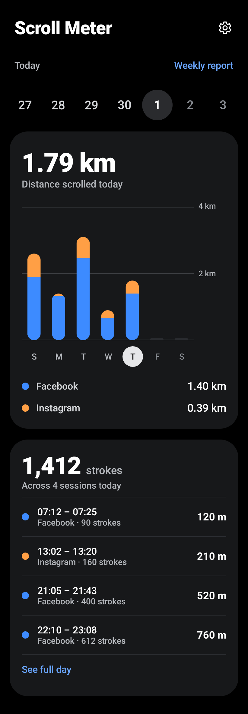
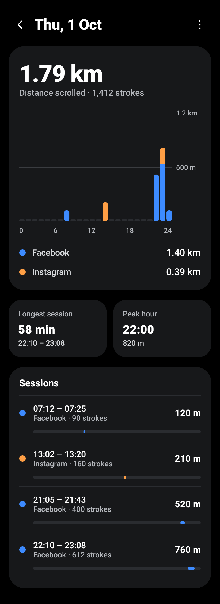
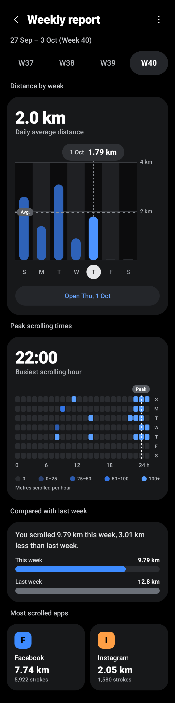
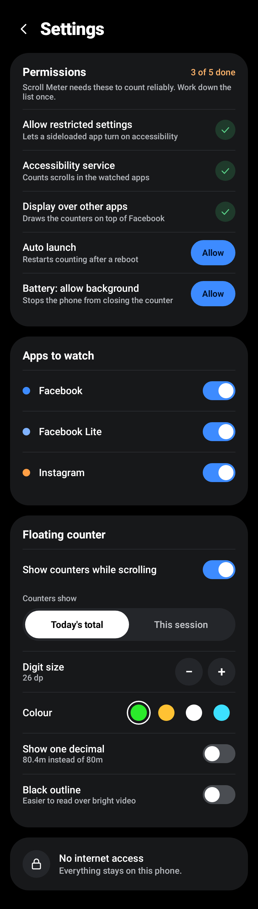
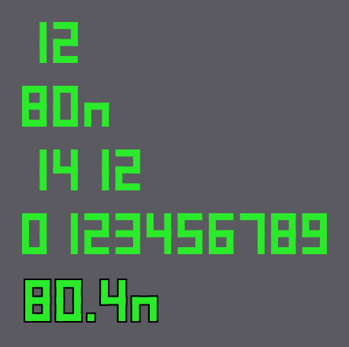

# Scroll Meter

A private Android app that shows one person how far they scroll on Facebook, Facebook Lite
and Instagram, measured in strokes (swipes) and real-world metres.

- **Floating HUD.** While a watched app is open, two small green seven-segment counters sit
  in the top corners: strokes on the left, metres on the right. They never block a tap.
- **Dashboard.** A dark, card-based app with today's distance, a weekly chart, a day view
  with hourly bars and sessions, a weekly report with a peak-hours heatmap, and settings.

A reality check measured in metres, not minutes.

## Status

Version 1 (features F1 to F10 of the PRD) builds and passes its automated tests. It has
**not yet been installed on a real phone or an emulator**, so behaviour on Android itself,
and how the real Facebook and Instagram apps report scrolling, is still unverified. The
PRD's manual checklist on the phone is the next step.

| Check | Result |
| --- | --- |
| Debug and release APK build | Pass |
| JVM tests (`./gradlew testDebugUnitTest`) | 94 of 94 pass |
| Android lint | 0 errors |
| APK has no `INTERNET` permission | Confirmed with `aapt2` |
| Run on a phone or emulator | Not done |

Details, flows and every difference from the specification are in
[FLOW_AND_FEATURES.md](FLOW_AND_FEATURES.md).

## Screens

Rendered from the real code by the screenshot test, with seeded data and the system font.

| Today | Day detail | Weekly report | Settings |
| --- | --- | --- | --- |
|  |  |  |  |

The floating HUD digits, drawn by the real view: 

## Requirements

- JDK 17 or 21
- Android SDK Platform 35 and Build-Tools 35. Installing Android Studio is the easiest way;
  the first build also downloads Gradle and the libraries (about 2 GB in total)
- A phone running **Android 11 or newer** (`minSdk 30`, `targetSdk 35`)

## Build the APK

From a terminal (the Gradle wrapper is included):

```bash
./gradlew assembleDebug assembleRelease
```

Or in Android Studio: open this folder, let it sync, then **Build > Build APK(s)**.

| File | Use |
| --- | --- |
| `app/build/outputs/apk/release/app-release.apk` | Everyday use on the phone (faster, about 20 MB) |
| `app/build/outputs/apk/debug/app-debug.apk` | First tests: it logs what the service receives (see [Tests](#tests)) |

Both are signed with the key in `signing/debug.keystore`, so either can be installed over
the other. That file is deliberately **not in git**. Back it up: Android refuses to update
an app signed with a different key, and uninstalling deletes the recorded data. To build on
another computer, copy the file into `signing/` there first. Without it, Gradle signs with
that computer's own debug key and the result can only be installed fresh.

If Gradle cannot find the SDK, create `local.properties` with
`sdk.dir=/path/to/Android/sdk` (Android Studio does this for you).

### Optional: the Plus Jakarta Sans font

The design uses Plus Jakarta Sans. The app falls back to the system font until you add it:

1. Download the family from Google Fonts.
2. Create the folder `app/src/main/res/font/`.
3. Copy four static TTF files into it with exactly these names:
   `plus_jakarta_sans_medium.ttf`, `plus_jakarta_sans_semibold.ttf`,
   `plus_jakarta_sans_bold.ttf`, `plus_jakarta_sans_extrabold.ttf`.

No code change is needed; the app finds them by name.

## Install and set up on the phone

1. Copy the APK to the phone and install it (or `adb install app-debug.apk`).
2. Android 13+: open **App info > ⋮ > Allow restricted settings**. Without this a sideloaded
   app cannot turn on accessibility.
3. Open Scroll Meter. The Setup screen opens by itself; work down the five rows:
   Allow restricted settings, Accessibility service, Display over other apps, Auto launch,
   Battery. Each **Allow** button opens the right system page.
4. Lock the app in the recents screen (on Realme: pull down on its card).
5. Open Facebook, swipe 10 reels and check the HUD counts 10.

The counters' size, colour, one-decimal metres and a black outline (for bright videos) can
be changed in **Settings > Floating counter**.

Optional: grant **Usage access** in system settings (Special app access). It is only used to
warn you when Facebook was used but nothing was counted.

Menu names differ between Realme UI versions.

## Tests

```bash
./gradlew testDebugUnitTest
```

This runs 94 JVM tests; no phone or emulator is needed.

| Tests | What they cover |
| --- | --- |
| `ScrollTrackerTest`, `ScrollEventInterpreterTest`, `HudTest`, `AggregatorTest`, `FmtAndSessionTest`, `ScreenStateTest` (81) | PRD tests U1 to U13: strokes, distance, sessions, midnight split, time zones, aggregation, formats, screen numbers, health check |
| `AppIntegrationTest` (4) | The real service, HUD views, database and activity under Robolectric, driven by fake accessibility events: HUD shows and hides, only downward scrolls in watched apps count, sessions are saved, resumed and closed on screen off, and the size / colour / decimal / outline settings restyle the live HUD |
| `ScreenshotTest` (9) | Renders every screen and the HUD digits to `app/build/screenshots/` |

`ScrollDaoTest` is an instrumented database test for a connected phone or emulator:

```bash
./gradlew connectedDebugAndroidTest
```

It compiles but has not been run. The emulator tests I2 and I6 and the manual checklist in
the PRD ("Manual checklist on the Realme phone") are still to do. The manual checklist
matters most: only the real phone shows whether Facebook and Instagram send usable scroll
events.

### Seeing what the service receives

Debug builds log the numbers of every scroll event (never any content):

```bash
adb logcat -s ScrollMeter
```

## How it works

```
Facebook / Instagram
        │  accessibility events (window changed, view scrolled)
        ▼
ScrollAccessibilityService ──► ScrollEventInterpreter ──► ScrollTracker
                                                            │        │
                                              live counters │        │ every 10 s
                                                            ▼        ▼
                                                     Floating HUD   Room database
                                                                        │
                                                                        ▼
                                                     Today · Day · Weekly · Settings
```

- A stroke is one burst of downward scroll events (a gap over 300 ms starts a new one;
  bursts under 24 dp are ignored). Each reel page is exactly one stroke.
- Distance = pixels ÷ the screen's physical vertical DPI × 0.0254.
- Activity is grouped into sessions and hourly totals. Raw events are never stored.

## Project layout

```
app/src/main/java/com/scrollmeter/app/
├── MainActivity.kt          activity, navigation back stack
├── ScrollMeterApp.kt        application + manual dependency container
├── model/                   the three watched apps
├── service/                 accessibility service, tracker, event interpreter, HUD
├── data/                    Room entities + DAO, repository, settings, aggregation
├── util/                    number / date formats, permission checks and deep links
└── ui/
    ├── theme/               colours and type from the design spec
    ├── components/          cards, switches, rows, the five hand-drawn charts
    └── today/ day/ weekly/ settings/   one screen + view model each
app/src/test/                JVM tests (logic, integration, screenshots)
app/src/androidTest/         database test for a phone or emulator
docs/screenshots/            screens rendered by the screenshot test
```

Stack: Kotlin, Jetpack Compose (Material 3, dark only), Room, DataStore, coroutines + Flow.
Charts are drawn by hand on a Compose `Canvas`; there is no chart library and no dependency
injection framework.

## Privacy

- No `INTERNET` permission. The app cannot send anything off the phone.
- The accessibility service reads only the event type, package name, view class name and
  scroll numbers. It never reads text or the view tree (`canRetrieveWindowContent` is false).
- Only Facebook, Facebook Lite and Instagram are counted; events from every other app are
  dropped unread.
- Data lives in app-private storage and is excluded from backups.
- No analytics, crash reporting or third-party SDKs.

## Documents

- [Flow and features](FLOW_AND_FEATURES.md): how everything connects, what was added or changed
- [Product requirements](Scroll%20Meter%20%E2%80%94%20Product%20Requirements.md)
- [Design spec](Scroll%20Meter%20%E2%80%94%20Design%20Spec.md)
